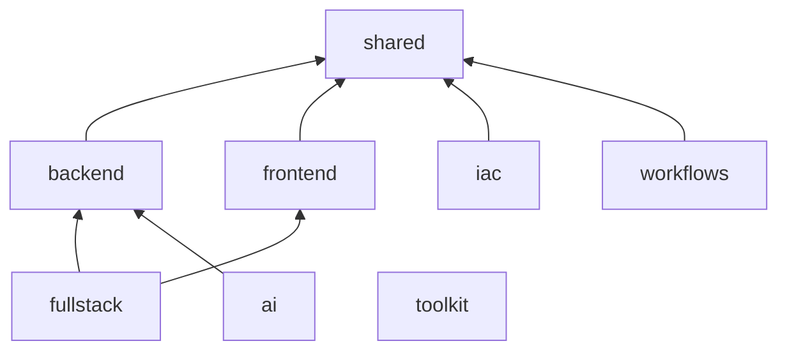

# Profiles

A profile is a named selection of bundles in [catalog.json](../../catalog.json).
It may extend other profiles; composition resolves inheritance into an ordered,
de-duplicated bundle union and copies only those bundles into a new package.
The catalog is the only profile source; this page explains it and must follow
it, never the reverse. For the technologies each bundle covers, see
[technology coverage](technology-coverage.md); for why selection is explicit, see
[design rationale](design-rationale.md).

## Profile table

| Profile | Extends | Own bundles | Effective bundles | Intended consumer |
| --- | --- | --- | --- | --- |
| shared | none | shared | shared | Any repository that wants conventions, context, planning, testing, documentation and agent workflows without a stack |
| backend | shared | backend | shared, backend | Python services, APIs, persistence, configuration, Pydantic v2, Polars 2 and packaging |
| frontend | shared | frontend | shared, frontend | Accessible React and TypeScript clients with browser testing |
| fullstack | backend, frontend | coordination | shared, backend, frontend, coordination | Repositories that change backend and frontend contracts together |
| iac | shared | iac | shared, iac | Infrastructure, containers, CI and observability review; usually added as a feature |
| workflows | shared | workflows | shared, workflows | Optional specification, code-graph, duplication and simplification workflows; usually added as a feature |
| ai | backend | ai | shared, backend, ai | Python applications with model clients, retrieval, graph workflows, queues or streaming |
| toolkit | none | toolkit, shared | toolkit, shared | This repository only: APM governance plus the shared kernel |

Effective bundles are listed in resolution order: parents first, then the
profile's own bundles, skipping any bundle already selected.



Arrows point from a profile to the profile it extends. `toolkit` lists the
shared bundle directly instead of extending the shared profile.

## Native roles per profile

Roles are defined in skill assets, so a profile delivers only the roles of its
selected bundles. Session compositions (`--skill`) deliver none.

| Role source (bundle, skill) | Roles | Delivered by |
| --- | --- | --- |
| shared, `kit-agent-runtime` | Primary: `kit-debug`, `kit-deep-thinking`, `kit-devops`, `kit-modernization`, `kit-orchestrator`, `kit-refactor`. Workers: `kit-codebase-researcher`, `kit-code-reviewer`, `kit-planner`, `kit-plan-architect`, `kit-solid-review`, `kit-security-reviewer`, `kit-devops-implementer`, `kit-docs-writer`, `kit-test-author` | every profile |
| backend, `kit-python-service` | Primary: `kit-ddd`, `kit-sdd`, `kit-tdd`, `kit-testing`. Workers: `kit-backend-implementer`, `kit-contract-iac-lint` | backend, fullstack, ai |
| frontend, `kit-react-feature` | Primary: `kit-frontend`. Worker: `kit-frontend-implementer` | frontend, fullstack |
| coordination, `kit-fullstack-workflow` | Coordinator: `kit-fullstack` (delegates to backend and frontend implementers, contract lint, code review and test authoring) | fullstack |
| iac, `kit-infra-review` | Worker: `kit-infra-reviewer` (read-only) | iac |
| ai, `kit-llm-evaluation` | Primary: `kit-ai-engineer`. Worker: `kit-eval-reviewer` (read-only) | ai |

A coordinator's workers must resolve inside the same selection, which is why
`kit-fullstack` is only delivered with both stacks present.

## Intended combinations

| Need | Command |
| --- | --- |
| Python service | `compose backend` |
| React client | `compose frontend` |
| Full-stack application | `compose fullstack` |
| Full-stack application with infrastructure | `compose fullstack --feature iac` |
| Python service with AI features and specs | `compose ai --feature workflows` |
| Narrow backend session | `compose backend --skill kit-python-service` |

`--feature` accepts any profile name and may be repeated. Features add their
effective bundles to the base profile's; duplicates collapse. The smoke matrix
uses three selections, `fullstack`, `ai` with `iac`, and `workflows`, that
together deliver every portable bundle and every declared role while each stays
within the profile description budget.

This repository's own native projections use `toolkit` with the `backend`
feature for both runtimes, declared in [self.json](self.json).

## Compose

```powershell
uv sync --locked
uv run --locked agent-kit check --root .
uv run --locked agent-kit compose fullstack --feature iac --runtime copilot --runtime claude --output build/fullstack
uv run --locked agent-kit provenance --root build/fullstack
```

- `--runtime` defaults to every runtime in the catalog (`copilot`, `claude`);
  repeat it to choose a subset. Values must be unique and supported.
- `--output` must not exist. Inside this checkout it must be beneath `build/`.
- Compose re-validates the source first and writes nothing if validation fails.
- Unknown profiles, features or skills fail before any output is created.

A composed package contains:

| Path | Purpose |
| --- | --- |
| `.apm/instructions/`, `.apm/skills/` | Selected source primitives and their resources |
| `.github/agents/`, `.claude/agents/` | Rendered native roles for the selected runtimes (project mode only) |
| `.apm/selection.json` | Mode, skill and instruction IDs, character counts, role file count |
| `apm.yml` | Generated manifest with explicit includes and compilation exclusions for skill trees |
| `apm-policy.yml`, `LICENSE` | Copied from the toolkit root |
| `provenance.json` | Source identity and SHA-256 hash of every other file |

### Session selection

```powershell
uv run --locked agent-kit compose backend --skill kit-python-service --runtime copilot --output build/session-backend
```

Session mode keeps general project instructions and policy, includes a
skill-specific instruction only when its same-named skill is selected, omits
native roles, and fails if a retained document links to a resource whose skill
was not selected. Add that skill explicitly with another `--skill`.

A session package does not hide parent, user or plugin capabilities in a host.
Use a separate reviewed workspace when native isolation matters.

## Verify a profile

| Check | Command | Proves |
| --- | --- | --- |
| Source budgets and metadata | `uv run --locked agent-kit check --root . --json` | Every profile's skill count, body lines and description total are within catalog budgets |
| Output integrity | `uv run --locked agent-kit provenance --root <package>` | No missing, extra or altered files since composition |
| APM policy and audit | `uv run --locked agent-kit apm-check --root <package>` | Provenance passes, then pinned `apm policy status` and `apm audit --ci` succeed |
| Real delivery | `task apm:smoke` and `task apm:smoke -- --session` | Install, compile, both native rosters, byte-identical resources and frozen reinstall |
| Resource depth | `uv run --locked python -m scripts.check_resources --json` | Linked references, assets and Python resource syntax per skill |
| Inventory coverage | `uv run --locked python -m scripts.check_coverage` | Original capabilities have replacements or recorded exclusions |

These checks do not certify behavior inside a live IDE, model or cloud
session; see [compatibility](../../docs/compatibility.md).

## Change a profile

1. Edit [catalog.json](../../catalog.json) only; keep inheritance acyclic.
2. Run `uv run --locked agent-kit check --root . --json` and confirm
   `profile_description_chars` stays within budget for every profile.
3. Compose the changed profile and every profile that extends it, then run
   provenance on each.
4. If the repository's own selection in [self.json](self.json) is affected,
   run `task verify -- roles` and refresh only through
   `uv run --locked python -m scripts.render_native --write`.
5. Update this page, [technology coverage](technology-coverage.md) and the
   root [README](../../README.md) table.
6. Run `task verify` and `task apm:smoke`.
