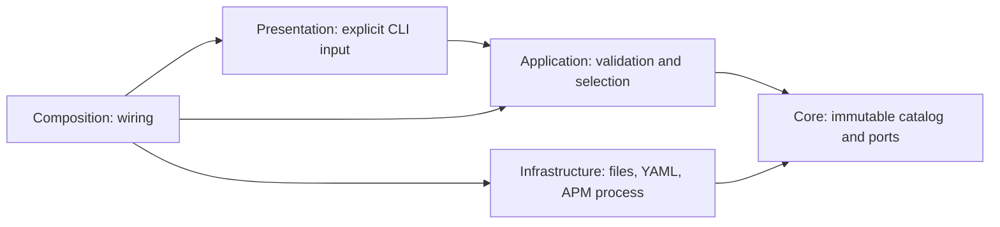

# Hexagonal Architecture (Ports and Adapters), with a layered application core

This is the toolkit's architecture label. The diagram shows this repository's
current layer names and dependency direction; consumers need not reproduce its
folders or layer names.

## Ownership

- [catalog.json](../../catalog.json): Opt-in bundle/profile resolution.
- `.apm/` and `packages/*/.apm/`: Canonical authored capabilities.
- `apm-policy.yml`: Explicit checked baseline, not implicit runtime authorization.
- Native agent definitions: Host-specific tools, kept outside portable prose.
- Composition: New staged package, atomically renamed only after validation.
- Provenance: Selected source and configuration hashes; never a fabricated release lock.
- Role source: Skill-contained JSON assets; pure native rendering preserves the
  shared procedure but emits only the selected provider's frontmatter/files.
- Completeness: Original inventory/disposition and actual resource pointers live
  in `.agents/agentic-setup/`; the root catalog remains the only profile source.
- Guard: `.agents/guard/` is a facade to the installed source checks, not another engine.

Infrastructure never imports Application. Core never reads files or invokes APM.
Validation is read-only. Composition cannot replace an existing destination.
The generated package excludes inactive bundles before recursive APM discovery.

## Glossary and relationship

- **Hexagonal Architecture (Ports and Adapters):** Keep application policy
  independent of outside actors and technologies through interaction ports
  and translating adapters. A port is an API; a normal application method or
  procedure can be a driving port without a separately declared Protocol.
- **Layered application core:** Organize internal responsibilities into layers
  when that makes policy and use cases clearer. Layer names and folder layouts
  vary by project; the diagram above describes this toolkit, not a required
  template.
- **Clean Architecture:** A related synthesis that explicitly draws on
  Hexagonal Architecture and other approaches. Both share inward dependency
  inversion; they are not opposing architectures. This toolkit uses Hexagonal
  Architecture as its canonical label.

Neither entity classes, separate inbound Protocol declarations, a Unit of Work,
nor exact layer folders are required to qualify. Policies may be functions or
data structures. Pydantic and configuration coupling are isolation trade-offs
to assess in context, not automatic disqualifiers. This toolkit's stdlib-only
Core rule is a local project constraint, not a universal Hexagonal requirement.

## Sources

- Alistair Cockburn, [Hexagonal Architecture](https://alistair.cockburn.us/hexagonal-architecture/):
  ports are APIs that may use ordinary procedure calls, and adapters isolate
  the application from input devices and databases.
- Robert C. Martin, [The Clean Architecture](https://blog.cleancoder.com/uncle-bob/2012/08/13/the-clean-architecture.html):
  Clean Architecture synthesizes related styles, including Hexagonal, and
  describes inward source dependencies.
- Microsoft, [Common web application architectures](https://learn.microsoft.com/en-us/dotnet/architecture/modern-web-apps-azure/common-web-application-architectures):
  overview of the related architecture family.
