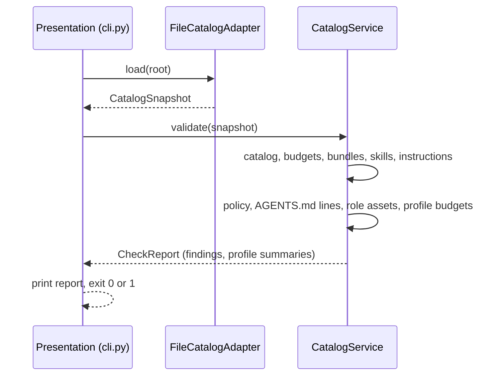
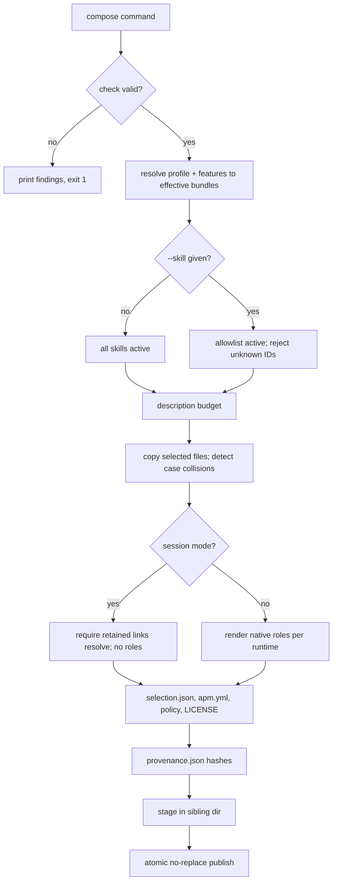
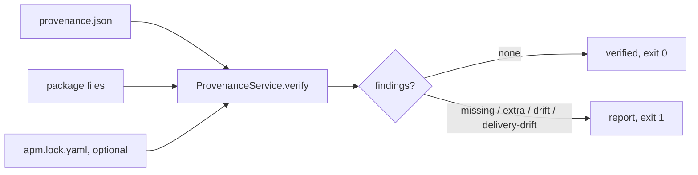
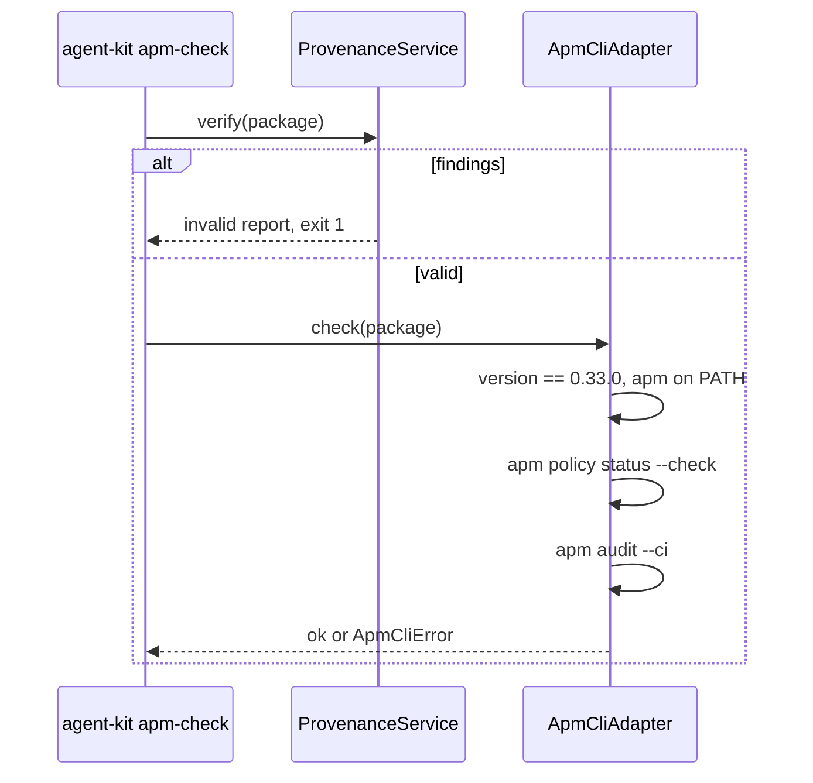
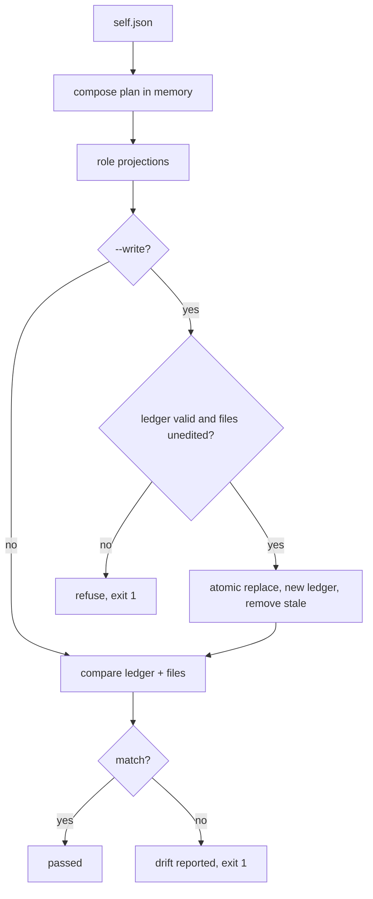
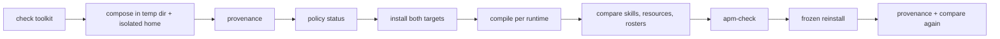
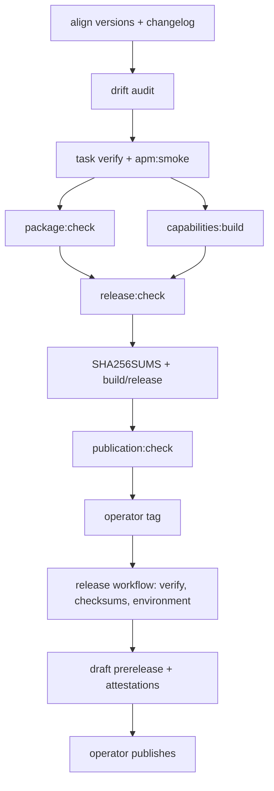

# Flows

Each flow lists the steps the code performs, in order, followed by a diagram.
Layer names follow the [architecture](architecture.md); terms follow the
[glossary](glossary.md). Commands assume the repository root and the locked
environment (`uv sync --locked`).

## Check

`uv run --locked agent-kit check --root . [--json]`

1. Presentation parses arguments; Composition supplies the root (the nearest
   ancestor containing `catalog.json` when `--root` is omitted).
2. Infrastructure (`FileCatalogAdapter.load`) captures the catalog, policy, root
   documents and every declared bundle's files into an immutable snapshot.
3. Application (`CatalogService.validate`) checks the catalog schema, budgets,
   bundle declarations against captured sources, profile references and cycles.
4. It validates each bundle manifest, skill and instruction: names, frontmatter,
   description and body budgets, hidden Unicode and contained local links.
5. It validates the strict policy (exact keys and values), the root `AGENTS.md`
   line budget, and native role assets for every supported runtime.
6. It checks the aggregate description budget of every declared profile.
7. Presentation prints `source catalog valid: <version>`, the findings, or the
   JSON report with per-profile counts; the exit code is 0 only when valid.

## Compose

`uv run --locked agent-kit compose <profile> [--feature F]... [--runtime R]... [--skill S]... --output <new path>`

1. Presentation runs Check first and stops on any finding.
2. Application rejects unknown profiles or features, duplicate or unsupported
   runtimes (default: all catalog runtimes), and resolves effective bundles.
3. It indexes available skills; with `--skill` it rejects duplicates and IDs
   outside the selected bundles, otherwise every available skill is active.
4. It enforces `profile_description_chars` on the active descriptions.
5. It copies selected bundle files, skipping inactive skills and, in session
   mode, instructions named after unselected skills; case-insensitive path
   collisions fail.
6. Session mode only: every retained document's local links must resolve inside
   the selection, otherwise it fails naming the missing resource.
7. Project mode only: role assets are rendered into native files per runtime.
8. It adds `.apm/selection.json`, a generated `apm.yml` (explicit includes,
   skill-tree compilation exclusions), `apm-policy.yml`, `LICENSE`, and finally
   `provenance.json` hashing every other file.
9. Infrastructure (`OutputAdapter.write`) rejects unsafe or occupied
   destinations, writes into a sibling staging directory, and publishes it with
   a no-replace rename.

## Provenance

`uv run --locked agent-kit provenance --root <package>`

1. Infrastructure (`load_composed`) captures the package files, `provenance.json`
   and, if present, the APM ledger `apm.lock.yaml`.
2. Application (`ProvenanceService.verify`) rejects symlinks and requires the
   exact provenance schema (`schema_version`, `source`, `files`).
3. It validates source identity and each recorded relative path and SHA-256
   digest, and requires hashes for `apm.yml`, `apm-policy.yml` and `LICENSE`.
4. It hashes every actual file. If an APM ledger exists, it accepts only
   project-scoped, first-party deployments under the skill, rule and instruction
   delivery roots and compares their line-ending-normalized bytes.
5. It reports missing recorded files, unrecorded extra files, altered files and
   delivery drift; ledger, root context and ignore metadata are permitted extras.
6. Presentation prints `composed output provenance verified` or the findings.

## APM check

`uv run --locked agent-kit apm-check --root <package>`

1. Run the Provenance flow; stop on any finding.
2. Infrastructure (`ApmCliAdapter.check`) requires the installed `apm-cli`
   distribution to be exactly 0.33.0 and an `apm` executable on the path.
3. With `APM_NO_SCRIPTS=1` and `APM_NON_INTERACTIVE=1`, run
   `apm policy status --policy-source ./apm-policy.yml --check --json`.
4. Run `apm audit --ci --policy ./apm-policy.yml --no-fail-fast`.
5. Any timeout, start failure or non-zero exit becomes an error without echoing
   APM's output; success prints `APM policy and audit checks passed`.

## Roles render

`task roles:check` (read-only) and `task roles:render` (explicit write).

1. Read [self.json](../agentic-setup/self.json) and require its exact schema.
2. Plan a composition for that profile, features and runtimes in memory and
   keep only `.github/agents/` and `.claude/agents/` files.
3. Check mode: require [native-lock.json](../agentic-setup/native-lock.json) to
   equal the planned hashes and every projection on disk to match byte for byte.
4. Write mode, before writing: validate the previous ledger, reject ledger paths
   outside the owned `kit-` role locations, and refuse if any owned file was
   edited independently or an unowned file already occupies a planned path.
5. Write mode: replace each file atomically, write the new ledger, delete roles
   no longer planned, and restore every touched file if anything fails.
6. Run the check again and report.

## Session context hook

1. The host fires `SessionStart` (startup, resume, clear or compact) and runs
   `uv run --locked agent-kit context` with a 10 second timeout.
2. The command reads at most one million characters of JSON from standard input.
3. It resolves the workspace and lists missing `AGENTS.md`, `PROJECT.md` or `llms.txt`.
4. It prints `hookSpecificOutput.additionalContext`; malformed input exits 1.
   Nothing is authorized or denied.

## APM smoke

`task apm:smoke` (three selections covering every portable bundle) or
`task apm:smoke -- --session`.

1. Require `apm-cli` 0.33.0 and the locked `apm` and `agent-kit` executables.
2. Run Check on the toolkit.
3. For each selection (`fullstack`; `ai` with `iac`; `workflows`; session
   mode `backend` with `--skill kit-python-service`), create a disposable
   directory with its own home, compose, and run Provenance.
4. Record expected skills, resource bytes and native roles; session mode must
   contain only the allowlist and no roles.
5. Run `apm policy status`, `apm install --only=apm` for both targets, and
   `apm compile` once per runtime.
6. Compare installed skills, resources and both native rosters with the source;
   run `agent-kit apm-check`; require `apm.lock.yaml`.
7. Reinstall with `--frozen`, rerun Provenance and the delivery comparison.

## Release

Operators own tagging and publication; local commands only prepare and verify.

1. Align Python, catalog, root APM and bundle versions; add a changelog entry.
2. Audit existing delivery (`task drift:check`) before regenerating owned output.
3. Run `task verify` and `task apm:smoke`.
4. Build products: `task package:check` (wheel and sdist into
   `build/distributions`) and
   `task capabilities:build -- --profile fullstack --feature iac`, which
   composes, verifies provenance and writes a deterministic ZIP without
   overwriting an existing archive.
5. `task release:check` checks the exact product inventory, metadata, licenses
   and version alignment, recomposes the source independently to compare bytes,
   writes basename-only `build/SHA256SUMS`, and stages the flat upload set in
   `build/release/`.
6. `task publication:check` requires approved ownership and private contacts.
7. Hosted: an operator pushes the reviewed tag; the release workflow reuses
   verification, checks checksums, waits for the `release` environment and
   creates attestations and a draft prerelease for an operator to publish.

See [releasing](../../docs/releasing.md) and
[verification](../../docs/verification.md) for the full contracts.
