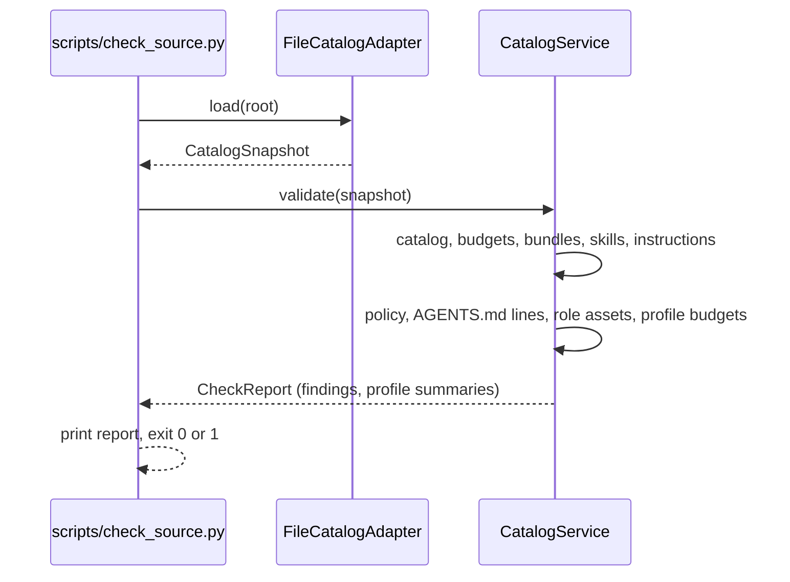
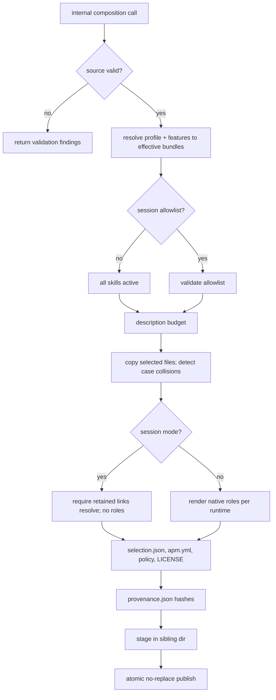
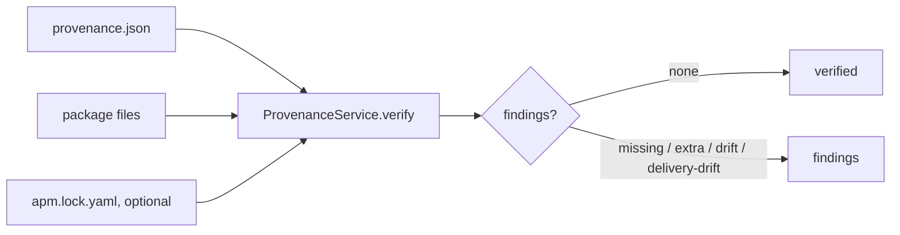
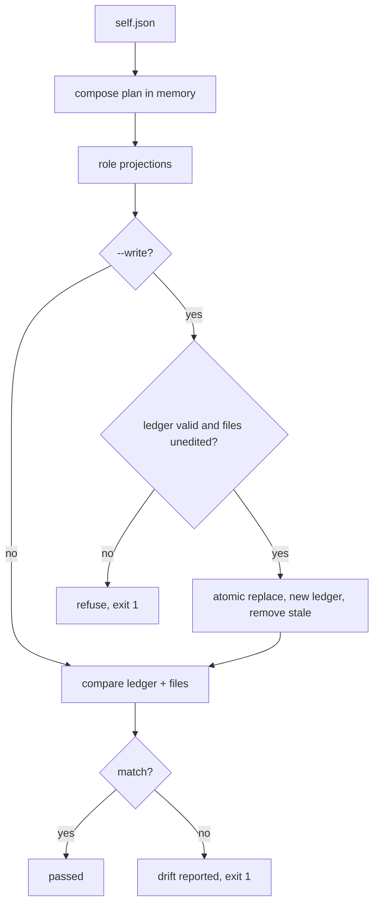
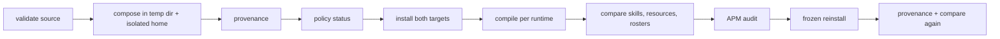

# Flows

Each flow lists the steps the code performs, in order, followed by a diagram.
Layer names follow the [architecture](architecture.md); terms follow the
[glossary](glossary.md). Commands assume the repository root and the locked
environment (`uv sync --locked`).

## Source validation

Maintainers run `task verify -- source` (implemented by
[`scripts/check_source.py`](../../scripts/check_source.py)); add `--json` to
that script for per-profile counts.

1. The script loads the catalog, policy, root
   documents and every declared bundle's files into an immutable snapshot.
2. `CatalogService.validate` checks the catalog schema, budgets,
   bundle declarations against captured sources, profile references and cycles.
3. It validates each bundle manifest, skill and instruction: names, frontmatter,
   description and body budgets, hidden Unicode and contained local links.
4. It validates the strict policy (exact keys and values), the root `AGENTS.md`
   line budget, and native role assets for every supported runtime.
5. It checks the aggregate description budget of every declared profile.
6. The script prints the result or a JSON report; the exit code is nonzero
   when source validation fails.

## Internal selection and composition

Selection and composition are internal Python library workflows used by
maintainer scripts; consumers do not invoke an Agent Kit command. The catalog
selects profile membership. Consumers install the corresponding generated
`profiles/<name>/apm.yml` meta-package through APM.

1. The application rejects invalid source, unknown profiles or features,
   duplicate or unsupported
   runtimes (default: all catalog runtimes), and resolves effective bundles.
2. It indexes available skills; an explicit session allowlist must not contain
   duplicates or IDs outside the selected bundles.
3. It enforces `profile_description_chars` on the active descriptions.
4. It copies selected bundle files, skipping inactive skills and, in session
   mode, instructions named after unselected skills; case-insensitive path
   collisions fail.
5. Session mode only: every retained document's local links must resolve inside
   the selection, otherwise it fails naming the missing resource.
6. Project mode only: role assets are rendered into native files per runtime.
7. It adds `.apm/selection.json`, a generated `apm.yml` (explicit includes,
   skill-tree compilation exclusions), `apm-policy.yml`, `LICENSE`, and finally
   `provenance.json` hashing every other file.
8. The output adapter rejects unsafe or occupied
   destinations, writes into a sibling staging directory, and publishes it with
   a no-replace rename.

## Internal provenance verification

The provenance library workflow verifies an internally composed package; it is
not a consumer-facing command.

1. Infrastructure (`load_composed`) captures the package files, `provenance.json`
   and, if present, the APM ledger `apm.lock.yaml`.
2. Application (`ProvenanceService.verify`) rejects symlinks and requires the
   exact provenance schema (`schema_version`, `source`, `files`).
3. It validates source identity and each recorded relative path and SHA-256
   digest, and requires hashes for `apm.yml`, `apm-policy.yml` and `LICENSE`.
4. It hashes every actual file. If an APM ledger exists, it accepts only
   project-scoped, first-party deployments under the skill, rule and instruction
   delivery roots and compares their line-ending-normalized bytes.
5. It reports missing recorded files, unrecorded extra files, altered files and
   delivery drift; ledger, root context and ignore metadata are permitted extras.
6. The workflow returns a valid report or findings.

## Roles render

`task verify -- roles` checks repository projections;
`uv run --locked python -m scripts.render_native --write` explicitly refreshes
them after review.

1. Read [self.json](../agentic-setup/self.json) and require its exact schema.
2. Plan a composition for that profile, features and runtimes in memory and
   keep only `.github/agents/` and `.claude/agents/` files.
3. Check mode: require [native-lock.json](../agentic-setup/native-lock.json) to
   equal the planned hashes and every projection on disk to match byte for byte.
4. Write mode, before writing: validate the previous ledger, reject ledger paths
   outside the owned `kit-` role locations, and refuse if any owned file was
   edited independently or an unowned file already occupies a planned path.
5. Write mode: replace each file atomically, write the new ledger, delete roles
   no longer planned, and restore every touched file if anything fails.
6. Run the check again and report.

## Session context hook

1. The host fires `SessionStart` and invokes
   `uv run --locked --no-sync python scripts/session_context.py` with a
   10-second timeout.
2. The adapter reads at most one million characters of JSON from standard input.
3. It resolves the workspace and lists missing `AGENTS.md`, `PROJECT.md` or `llms.txt`.
4. It prints `hookSpecificOutput.additionalContext`; malformed input exits 1.
   Nothing is authorized or denied.

## APM smoke

`task apm:smoke` (four bounded selections covering every portable bundle) or
`task apm:smoke -- --session`.

1. Require `apm-cli` 0.33.0 and its pinned `apm` launcher.
2. Validate the toolkit source and create a disposable package for each
   selection (`fullstack`; `ai` with `terraform`, `bicep` and `remote-access`;
   `workflows`; `backend` with `temporal` and `identity`). Session mode tests
   `backend` with `kit-python-service` unless skills are explicitly supplied.
3. Run internal provenance verification and record expected skills, resource
   bytes and native roles; session mode must
   contain only the allowlist and no roles.
4. Run `apm policy status`, install for both targets, and
   `apm compile` once per runtime.
5. Compare installed skills, resources and both native rosters with the source;
   audit and require `apm.lock.yaml`.
6. Reinstall with `--frozen`, rerun provenance and delivery comparisons.

The smoke exercises source packages directly. It does not certify resolution of
a published consumer profile's dependency closure; see
[compatibility](../../docs/compatibility.md#package-boundaries).

## Release

Release commands and operator boundaries are owned by the
[releasing guide](../../docs/releasing.md); verification gates are owned by
[verification](../../docs/verification.md).
