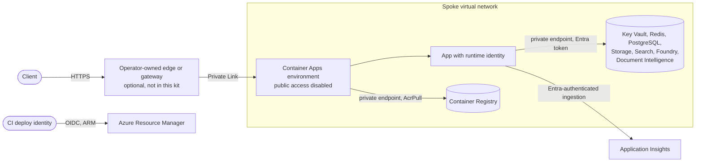

# Identity, access and network

This guide is the least-privilege contract for the Azure compositions in this
package: which identities exist, which roles each holds at which scope, how
traffic flows, and what production requires. A test keeps the role IDs below in
sync with the templates and the bootstrap script.

Checked offline only: the templates compile and their tests pass, but no Azure
tenant, network or deployment was exercised.

## Identities

Use managed identities and federated credentials. No identity in this design has
a password, client secret or access key.

| Identity | Kind | Created by | Used for |
| --- | --- | --- | --- |
| Operator | Person, ideally through [Privileged Identity Management](https://learn.microsoft.com/en-us/entra/id-governance/privileged-identity-management/pim-configure) | Tenant | One-time setup: bootstrap, environment protection, Private Link approval |
| Deploy | User-assigned managed identity, one per environment | [Bootstrap](bootstrap.md) or the platform team | CI preview and deployment through a federated credential for that environment only |
| Runtime | User-assigned managed identity, one per application and environment | The caller, before the data compositions | The running container: image pull, secrets, data and AI access |
| Indexing (optional) | Managed identity of an indexing job | The caller | Writing AI Search indexes |
| API Management | System-assigned identity | [API Management](../infra/api-management) | Publishing gateway metrics |
| Database administrator | Entra group | Tenant | PostgreSQL administration; never the runtime identity |

Create the runtime identity before the compositions that grant it access, and pass
its resource ID to Container Apps as `existingIdentityResourceId`. Container Apps
otherwise creates its own identity that nothing has authorized yet.

## Data-plane roles

Every grant targets one resource or child resource, never a resource group, and
uses principal type `ServicePrincipal`. Assignment names are deterministic, so a
rerun updates rather than duplicates.

| Composition | Role | Role ID | Principal input |
| --- | --- | --- | --- |
| [Foundry](../infra/ai-foundry) account | Cognitive Services OpenAI User | `5e0bd9bd-7b93-4f28-af87-19fc36ad61bd` | `principalId` |
| [Foundry](../infra/ai-foundry) project | Foundry User | `53ca6127-db72-4b80-b1b0-d745d6d5456d` | `principalId` |
| [AI Search](../infra/ai-search) | Search Index Data Reader | `1407120a-92aa-4202-b7e9-c0e197c71c8f` | `principalId` |
| [AI Search](../infra/ai-search) | Search Index Data Contributor | `8ebe5a00-799e-43f5-93ac-243d3dce84a7` | `indexingPrincipalId` (optional) |
| [Application Insights](../infra/application-insights), [API Management](../infra/api-management) | Monitoring Metrics Publisher | `3913510d-42f4-4e42-8a64-420c390055eb` | `principalId`; API Management's own identity |
| [Container Registry](../infra/container-registry) | AcrPull | `7f951dda-4ed3-4680-a7ca-43fe172d538d` | `pullPrincipalId` |
| [Container Registry](../infra/container-registry) | AcrPush | `8311e382-0749-4cb8-b61a-304f252e45ec` | `pushPrincipalId` (optional, the CI identity) |
| [Document Intelligence](../infra/document-intelligence) | Cognitive Services User | `a97b65f3-24c7-4388-baec-2e87135dc908` | `principalId` |
| [Key Vault](../infra/key-vault) | Key Vault Secrets User | `4633458b-17de-408a-b874-0445c86b69e6` | `principalId` |
| [Storage account](../infra/storage-account), [Terraform state](../infra/terraform-state) | Storage Blob Data Contributor | `ba92f5b4-2d11-453d-a403-e96b0029c9fe` | `principalId`: runtime, on each created container or else the account; deploy identity on the state container |

Three compositions authorize without Azure RBAC, so the role condition below does
not cover their grants:

- [Cosmos DB](../infra/cosmos-db) adds a Cosmos DB SQL role assignment of Cosmos
  DB Built-in Data Contributor, a data-plane role, for `principalId` on the
  account. Local (key) authentication stays disabled.
- [Managed Redis](../infra/managed-redis) adds an access-policy assignment for
  `principalId` on the default database. Access keys stay disabled.
- [PostgreSQL](../infra/postgresql) sets one Entra administrator, preferably a
  group. That administrator creates a database role for the runtime identity with
  `pgaadauth_create_principal` and grants only the tables it needs; see the
  composition's README. Never make the runtime identity the administrator.

Keys and local authentication are disabled where the service allows it: Foundry,
AI Search, Document Intelligence and Cosmos DB set `disableLocalAuth`; storage
disables shared keys; Managed Redis disables access keys; PostgreSQL disables
passwords; Key Vault uses the RBAC permission model; Container Registry keeps the
service default with the admin user disabled; Application Insights disables
local authentication outside `dev`. The deploy identity can turn each of these
back on; see [deploy identity limits](#deploy-identity-limits).

A consumer that only reads, such as a second application reading blobs, needs the
matching reader role from the resource owner. Add it in the caller's template rather
than widening these roles.

## Deployment roles

The deploy identity needs to create resources and assign the data-plane roles
above, and nothing else. On the target resource group grant:

| Role | Role ID | Constraint |
| --- | --- | --- |
| Contributor | `b24988ac-6180-42a0-ab88-20f7382dd24c` | Resource group only |
| Role Based Access Control Administrator | `f58310d9-a9f6-439a-9e8d-f62e7b41a168` | Condition below: only the data-plane role IDs, only service principals |

Contributor cannot assign roles. The RBAC Administrator role can, so it is
[constrained](https://learn.microsoft.com/en-us/azure/role-based-access-control/delegate-role-assignments-examples)
to the data-plane roles and to principal type `ServicePrincipal`. The identity
therefore cannot grant Owner, User Access Administrator, Contributor or any role
outside that list, and cannot grant anything to a person or group. It can still
grant itself every role in the list and gain other rights through Contributor;
see [deploy identity limits](#deploy-identity-limits). The condition, version
`2.0`, with the role IDs sorted:

```text
((!(ActionMatches{'Microsoft.Authorization/roleAssignments/write'})) OR (@Request[Microsoft.Authorization/roleAssignments:RoleDefinitionId] ForAnyOfAnyValues:GuidEquals {1407120a-92aa-4202-b7e9-c0e197c71c8f, 3913510d-42f4-4e42-8a64-420c390055eb, 4633458b-17de-408a-b874-0445c86b69e6, 53ca6127-db72-4b80-b1b0-d745d6d5456d, 5e0bd9bd-7b93-4f28-af87-19fc36ad61bd, 7f951dda-4ed3-4680-a7ca-43fe172d538d, 8311e382-0749-4cb8-b61a-304f252e45ec, 8ebe5a00-799e-43f5-93ac-243d3dce84a7, a97b65f3-24c7-4388-baec-2e87135dc908, ba92f5b4-2d11-453d-a403-e96b0029c9fe} AND @Request[Microsoft.Authorization/roleAssignments:PrincipalType] ForAnyOfAnyValues:StringEqualsIgnoreCase {'ServicePrincipal'})) AND ((!(ActionMatches{'Microsoft.Authorization/roleAssignments/delete'})) OR (@Resource[Microsoft.Authorization/roleAssignments:RoleDefinitionId] ForAnyOfAnyValues:GuidEquals {1407120a-92aa-4202-b7e9-c0e197c71c8f, 3913510d-42f4-4e42-8a64-420c390055eb, 4633458b-17de-408a-b874-0445c86b69e6, 53ca6127-db72-4b80-b1b0-d745d6d5456d, 5e0bd9bd-7b93-4f28-af87-19fc36ad61bd, 7f951dda-4ed3-4680-a7ca-43fe172d538d, 8311e382-0749-4cb8-b61a-304f252e45ec, 8ebe5a00-799e-43f5-93ac-243d3dce84a7, a97b65f3-24c7-4388-baec-2e87135dc908, ba92f5b4-2d11-453d-a403-e96b0029c9fe} AND @Resource[Microsoft.Authorization/roleAssignments:PrincipalType] ForAnyOfAnyValues:StringEqualsIgnoreCase {'ServicePrincipal'}))
```

[Bootstrap](bootstrap.md) with `--access deploy` creates exactly these two
assignments; its default grants Reader only. A platform team may assign the same
roles instead. Neither role can write `Microsoft.Authorization/locks`, so any
deploy that creates `CanNotDelete` locks (the compositions in `prod`, the starter
in `staging` and `prod`) also needs a custom role on the resource group with only
`Microsoft.Authorization/locks/read` and `Microsoft.Authorization/locks/write`. It
has no delete, so CI cannot remove protection. An operator creates and assigns it
before the first prod-like deploy; see [deletion locks](bootstrap.md#deletion-locks).
Two compositions need more than the resource group:

- Terraform state: the [state composition](../infra/terraform-state) grants the
  deploy identity Storage Blob Data Contributor on the state container.
- [Audit logs](../infra/audit-logs) writes a subscription diagnostic setting, which
  needs [Monitoring Contributor](https://learn.microsoft.com/en-us/azure/azure-monitor/fundamentals/roles-permissions-security)
  (`749f88d5-cbae-40b8-bcfc-e573ddc772fa`) at subscription scope. Deploy it from a
  separate platform identity, not the application's.

## Deploy identity limits

The role condition bounds which roles the deploy identity assigns, not who
receives them, and Contributor reaches beyond role assignments. Anyone who
obtains the identity's token, for example through a workflow change that runs
in its environment, can therefore:

- **Grant itself delegable roles.** The condition checks the role and the
  principal type, not the principal. The identity can assign itself, or a service
  principal it controls, any data-plane role above, such as Key Vault Secrets
  User or Storage Blob Data Contributor.
- **Write service-native grants.** Contributor can create Cosmos DB SQL role
  assignments and Managed Redis access-policy assignments for any principal.
  Azure RBAC conditions do not apply to them.
- **Re-enable keys and local authentication.** Contributor can turn shared keys,
  access keys, local authentication or the registry admin user back on and then
  list the keys, which bypasses Entra authorization entirely.
- **Federate itself.** When the identity lives in the resource group it deploys,
  Contributor can add a federated credential that trusts another repository,
  branch or issuer.

The condition does not exclude the identity's own principal ID. The starter
grants its deploy identity AcrPush on the registry it creates (`deployer()` in
Bicep, the client configuration in Terraform), and a self-exclusion would deny
that assignment. Moving that grant to an operator is the prerequisite for adding
`@Request[Microsoft.Authorization/roleAssignments:PrincipalId] StringNotEquals <principal ID>`
to the condition.

Bound the identity with controls it cannot change. Contributor excludes
`Microsoft.Authorization/*/Write`, so it cannot create, change or exempt Azure
Policy assignments:

- **Deny local authentication with Azure Policy.** An operator assigns these
  built-in definitions with effect `Deny` at subscription or management-group
  scope, not on the deploy resource group. Start with `Audit` to find existing
  resources that would be refused, then switch to `Deny`.

  | Built-in policy definition | Definition ID | Effects |
  | --- | --- | --- |
  | Cosmos DB database accounts should have local authentication methods disabled | `5450f5bd-9c72-4390-a9c4-a7aba4edfdd2` | Audit, Deny, Disabled |
  | Azure AI Services resources should have key access disabled (disable local authentication) | `71ef260a-8f18-47b7-abcb-62d0673d94dc` | Audit, Deny, Disabled |
  | Storage accounts should prevent shared key access | `8c6a50c6-9ffd-4ae7-986f-5fa6111f9a54` | Audit, Deny, Disabled |
  | Container registries should have local admin account disabled. | `dc921057-6b28-4fbe-9b83-f7bec05db6c2` | Audit, Deny, Disabled |
  | Azure Key Vault should use RBAC permission model | `12d4fa5e-1f9f-4c21-97a9-b99b3c6611b5` | Audit, Deny, Disabled |
  | [Preview]: Azure PostgreSQL flexible server should have Microsoft Entra Only Authentication enabled | `fa498b91-8a7e-4710-9578-da944c68d1fe` | Audit, Disabled |

  The PostgreSQL built-in can only audit. To deny, copy its rule into a custom
  definition whose effect is `deny`. Add the equivalent definitions for AI Search,
  Managed Redis and Application Insights from the
  [built-in policy reference](https://learn.microsoft.com/en-us/azure/governance/policy/samples/built-in-policies)
  where you use them; Application Insights keeps local authentication in `dev`.
- **Keep the identity out of its own resource group.** Create the deploy identity
  in a separate identity resource group where CI has no role, so Contributor on
  the deploy group cannot add federated credentials to it. [Bootstrap](bootstrap.md)
  creates the identity in the deploy group, so this is a platform-team step.
- **Alert on grants.** Raise Activity Log alerts on writes to
  `Microsoft.Authorization/roleAssignments`,
  `Microsoft.DocumentDB/databaseAccounts/sqlRoleAssignments`,
  `Microsoft.Cache/redisEnterprise/databases/accessPolicyAssignments` and
  `Microsoft.ManagedIdentity/userAssignedIdentities/federatedIdentityCredentials`,
  and review grants whose principal is the deploy identity.
- **Pre-assign where self-delegation matters.** A platform team assigns
  equivalent roles itself and bootstrap keeps the default `--access read`, so the
  pipeline holds no role-assignment right; see
  [access levels](bootstrap.md#access-levels).

## Network

The [network composition](../infra/network) creates one spoke virtual network for
standalone use:

- an apps subnet delegated to `Microsoft.App/environments`, at least `/27` for a
  [workload profiles environment](https://learn.microsoft.com/en-us/azure/container-apps/custom-virtual-networks);
- a private-endpoint subnet;
- a network security group on each subnet;
- an explicit egress path for the apps subnet (see [Egress](#egress));
- optionally, private DNS zones linked to the virtual network.

In an [Azure landing zone](https://learn.microsoft.com/en-us/azure/cloud-adoption-framework/ready/landing-zone/)
the platform team owns peering, egress firewall, DNS zones and DNS resolution.
Pass their existing subnet and zone IDs instead and leave `privateDnsZones` empty.

Each data composition takes `privateEndpoint: { subnetId, privateDnsZoneId }`
(Foundry takes `privateDnsZoneIds` with its three zones), creates the endpoint
and its DNS zone group, and disables public network access. `staging` and
`prod` refuse to deploy without it. In `dev` and `test`, compositions stay
private unless `allowPublicNetworkAccess` is set, which denies by default and
admits only `allowedIpRanges`. Two exceptions stay open to every network:
Foundry with `allowAllPublicClients` (Entra-only, used by the starter's dev
stage), and a Basic or Standard Container Registry, which cannot use network
rules. The Terraform state account follows the same
rule: give it a private endpoint or the runners' fixed egress IPs, because
hosted agents have no stable address. With the network composition, set `subnetId` to its
`privateEndpointSubnetResourceId` output and each zone ID from
`privateDnsZoneResourceIds`, and set the Container Apps
`availability.infrastructureSubnetId` to `appsSubnetResourceId`.

The network README's [zone table](../infra/network/README.md#contract) is the
single list of private DNS zones. It covers every private endpoint group these
compositions create, including Foundry's three zones and the per-region
Container Apps zone, plus the other Storage sub-resources and the Azure Monitor
Private Link Scope zones. Zone names follow
[Private endpoint DNS](https://learn.microsoft.com/en-us/azure/private-link/private-endpoint-dns).

With an internal Container Apps environment, the module links the
environment's default-domain DNS zone to the infrastructure virtual network.
For clients in a hub or peered virtual network, add their IDs to
`linkedVirtualNetworkIds`. It is accepted only with `internalEnvironment`;
peering and DNS forwarding stay with the platform team. See
[Container Apps private access](../infra/container-apps/README.md#private-access-and-public-exposure).

### Egress

The apps subnet has no default outbound access, so the network composition's
`egress` option sets its outbound path:

- `natGateway`: a NAT gateway with one static public IP;
- `routeTable`: an existing route table, typically to a hub firewall;
- `platform`: the path that Container Apps manages.

The default is `natGateway` for `staging` and `prod` and `platform` for `dev` and
`test`. An explicit value always wins. A NAT gateway and its public IP are billed
hourly plus data processed, so opt a stage out with `platform` if the cost is not
justified. See the [egress decision](../infra/network/README.md#egress).

### Staging

`staging` is prod-like where the network and Container Apps compositions decide:

- the Container Apps environment needs zone redundancy, at least 2 replicas and
  an internal environment or a private endpoint;
- the apps subnet defaults to a NAT gateway.

Deletion locks are not part of that. Container Apps requires
`deletionProtection` only in `prod`, and the network composition locks only in
`prod`. The starter opts `staging` into locks too. See
[Container Apps inputs](../infra/container-apps/README.md#inputs).

## Traffic



- **Inbound.** Staging and production are private, and this repository ships no
  edge, WAF or global-routing module. Clients reach the app from linked virtual
  networks, or through an edge the operator adds outside this kit, such as Azure
  Front Door Premium with a
  [Private Link origin](https://learn.microsoft.com/en-us/azure/container-apps/how-to-integrate-with-azure-front-door)
  (sub-resource `managedEnvironments`), Application Gateway or API Management. An
  edge's connection request stays pending until an operator approves it on the
  environment:

  ```shell
  az network private-endpoint-connection list --id <environment-id>
  az network private-endpoint-connection approve --id <connection-id> --description "Edge origin"
  ```

  An edge can create several requests; approve each one. See
  [public exposure](../infra/container-apps/README.md#public-exposure).
- **Public name.** The edge owns its public domain and certificate. Without an
  edge, use the Container Apps `customDomain` below (public environments only).
- **Container Apps custom domain.** In public environments only, `customDomain`
  adds one subdomain with a free managed certificate in three deployments:
  without `customDomain` (then create the CNAME and `asuid` TXT records from the
  outputs), with `customDomain`, and with `bindCertificate: true`. It is
  rejected for internal environments, private endpoints and disabled public
  access, so staging and prod need an operator-owned edge instead. See
  [custom domain](../infra/container-apps/README.md#custom-domain-opt-in).
- **Users and callers.** Container Apps `authentication` turns on Entra built-in
  authentication: API mode returns `401` without a bearer token; sign-in mode
  redirects browsers and outputs the callback URL to register on the app
  registration. The app authorizes with token roles or groups. API Management
  validates tokens again at the gateway when configured.
- **Within the environment.** Apps reach each other on the environment's internal
  domain. Only the ingress you enable is reachable.
- **To data and AI services.** The app resolves each service to its private
  endpoint and authenticates with its runtime identity. No connection string
  contains a secret.
- **Telemetry.** Application Insights ingestion stays on its public endpoint
  with Entra authentication. An
  [Azure Monitor Private Link Scope](https://learn.microsoft.com/en-us/azure/azure-monitor/logs/private-link-security)
  changes DNS for every network that shares it, so the platform team owns it.
- **Deployment.** CI reaches Azure Resource Manager over its public endpoint.
  The Terraform state account denies public clients by default: allow the fixed
  egress addresses of self-hosted runners in `allowedIpRanges`, or give it a
  private endpoint and run Terraform from runners inside the network.
  GitHub-hosted runners and Microsoft-hosted agents have no fixed egress address.

## Stage gates

| Control | `dev` | `test` | `staging` | `prod` |
| --- | --- | --- | --- | --- |
| Private endpoints for data, AI and the environment | Private by default; explicit public opt-in | Private by default; explicit public opt-in | Required | Required |
| Public edge (WAF, gateway) | Operator-owned, not shipped | Operator-owned, not shipped | Operator-owned, not shipped | Operator-owned, not shipped |
| API Management | Basic v2 | Basic v2 | Basic v2 | Standard v2 |
| Local authentication | Disabled except Application Insights | Disabled | Disabled | Disabled |
| Deletion locks | None | None | None | `CanNotDelete` |
| Diagnostics workspace | Optional | Optional | Required | Required |
| Deploy approval | None | Required reviewers when `protected` | Required reviewers when `protected` | Required reviewers |
| Deploy environment rules (GitHub, enforced by preflight when protected) | None | No self-review, no administrator bypass, restricted branches when `protected` | No self-review, no administrator bypass, restricted branches when `protected` | No self-review, no administrator bypass, restricted branches |

## Platform-owned controls

These are tenant or subscription concerns outside an application's templates:

- the hub firewall, its route tables and DDoS protection (the network
  composition only associates an existing route table);
- [virtual network flow logs](https://learn.microsoft.com/en-us/azure/network-watcher/vnet-flow-logs-overview),
  which replace NSG flow logs;
- [Azure Policy](https://learn.microsoft.com/en-us/azure/governance/policy/overview)
  that denies public network access and audits private endpoints;
- Azure Policy that denies local authentication and keys, assigned above the
  deploy resource group; see [deploy identity limits](#deploy-identity-limits);
- central private DNS and the Azure Monitor Private Link Scope;
- just-in-time operator access through Privileged Identity Management;
- [audit logs](../infra/audit-logs) for role and policy changes.

## Limits

- For the same, identically cased resource and principal IDs, Bicep `guid()`
  and Terraform `uuidv5()` give each role assignment the same name, but state
  and ownership do not transfer. Deploy an environment with one tool only;
  switching tools needs a reviewed import and state migration.
- Role assignments can take several minutes to propagate. A first deployment
  whose app starts before its grants apply may need one restart.
- Built-in role IDs are stable, but role names change; for example, Foundry User
  was formerly Azure AI User.
