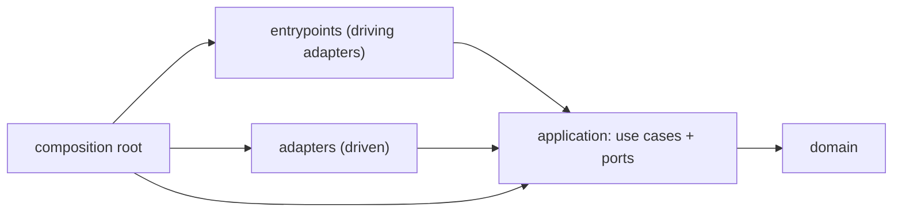

# Ports, adapters and the dependency rule

## Vocabulary

| Term | Meaning | Python shape |
| --- | --- | --- |
| Application (the hexagon) | Policy you want to keep when technology changes | `domain` and `application` packages |
| Port | A purposeful conversation the application has with the outside | an ordinary function/method, or a `typing.Protocol` |
| Adapter | Code that translates between one technology and one port | a class or function in `adapters/` or `entrypoints/` |
| Driving (primary) side | Actors that start an interaction: users, tests, schedulers, other services | CLI command, HTTP handler, queue consumer |
| Driven (secondary) side | Things the application calls out to: storage, payment providers, mail, clocks | repository, client, notifier adapters |
| Composition root | The single place that picks concrete adapters and wires them in | `app/composition.py`, a `main()` function |

A port is named for *why* the application talks, not *how*: `PaymentGateway.charge`,
not `StripeClient.post_json`. If a port's method names only make sense for one
vendor, the vendor has leaked into the core.

## Driving ports need no extra interface

The public call of a use case is already the driving port. A CLI handler that
calls `SettleInvoice(...)(command)` is a driving adapter; a test that calls the
same object is another driving adapter. Declaring a `SettleInvoicePort`
Protocol that the use case then implements adds a file and no substitution
point: nobody swaps the application for a fake application. Add an inbound
Protocol only when several interchangeable implementations really exist (for
example a read model served from two stores behind one query interface).

## Driven ports are where Protocols earn their keep

On the driven side the application *calls out*, so it must name the
capability it needs without importing the technology. `typing.Protocol`
expresses that structurally: any class with matching members satisfies the
port, so a fake in `tests/` and the real adapter in `adapters/` need no shared
base class. Explicitly subclassing the Protocol is still useful: a type checker
then reports a missing method at the class definition rather than at the
injection site, and [`check_ports_adapters.py`](../assets/check_ports_adapters.py)
treats the base as a declaration of intent.

Keep ports small and cohesive:

- One port per collaborator role (`InvoiceRepository`, `PaymentGateway`,
  `InvoiceNotifier`, `Clock`), not one per technology or one for "the database".
- Parameters and results are domain types or small port-owned value objects
  (`PaymentReceipt`), never `dict[str, object]` from a wire format, ORM rows,
  HTTP responses or SDK objects.
- Errors are part of the port. Define them next to the port
  ([`payment_errors.py.template`](../assets/payment_errors.py.template)) and
  classify them by what the caller should do (decline, retry, alert).
- Prefer keyword-only parameters for anything that is not obvious by position;
  adapters must then keep the same parameter names, which the checker verifies.

A plain callable type is often enough for one-method collaborators:
`type Clock = Callable[[], datetime]` is a complete port.

## The dependency rule

Source-code imports point inward: entrypoints and adapters import the
application; the application imports the domain; the domain imports nothing
from the project's outer layers. Runtime calls still go outward (a use case
calls an adapter), which is possible because the adapter is *injected* as an
object typed by a port that lives in the application.

Practical consequences:

- A port module never imports an adapter module. The adapter imports the port.
- Adapter-specific exceptions (`sqlite3.IntegrityError`, `urllib.error.URLError`)
  are caught inside the adapter and re-raised as port exceptions with the
  original chained (`raise PortError(...) from error`).
- Configuration (environment variables, files, secrets stores) is read in the
  composition root or a driving adapter and passed inward as values.
- Logging is fine everywhere; the logging *configuration* belongs to the
  composition root.

Enforce the rule mechanically with an import contract
([`importlinter.ini.template`](../assets/importlinter.ini.template)). A layers
contract catches inward-to-outward imports, including indirect ones; a forbidden
contract keeps named frameworks out of the core. To keep standard-library I/O
modules such as `sqlite3` or `smtplib` out of the core, Ruff's `banned-api`
rule (TID251) can be scoped to the core packages.

## Where shared types live

| Type | Home | Reason |
| --- | --- | --- |
| Entity/value with invariants | domain | policy, reusable by many use cases |
| Use-case command/result | the use-case module | shape of one interaction |
| Port value object (`PaymentReceipt`) | the port module | owned by the application, implemented by adapters |
| Port exception | next to the port | part of the port contract |
| Wire DTO / ORM model | the adapter | technology detail |

## Sizing the boundary

Not every dependency needs a port. Pure, deterministic libraries (`decimal`,
`dataclasses`, a date library) are used directly. Add a port when at least one
holds: the dependency does I/O, is slow or nondeterministic, is likely to be
replaced, or must be faked to test a rule. Remove a port that only forwards
arguments to one adapter and is never substituted, faked or contract-tested.

## Sources

- Alistair Cockburn, [Hexagonal architecture](https://alistair.cockburn.us/hexagonal-architecture/)
- Python typing specification, [Protocols](https://typing.python.org/en/latest/spec/protocol.html)
- [PEP 544: Protocols: Structural subtyping](https://peps.python.org/pep-0544/)
- Import Linter, [Layers contract](https://import-linter.readthedocs.io/en/stable/contract_types/layers/)
  and [Forbidden contract](https://import-linter.readthedocs.io/en/stable/contract_types/forbidden/)
- Ruff, [banned-api (TID251)](https://docs.astral.sh/ruff/rules/banned-api/)
