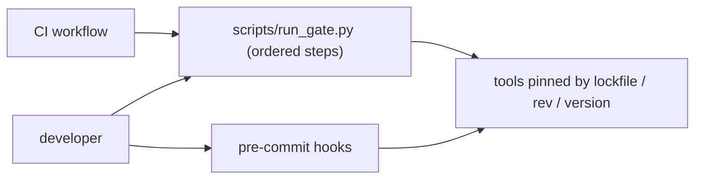

# Pre-commit and CI parity

"It passed locally" is only useful if local checks and CI checks are the same
checks, with the same versions, on the same files. Drift between them produces
either surprise CI failures or, worse, CI passes for code that local hooks
would have rejected.

## One definition, three entry points

- The gate script ([`run_gate.py.template`](../assets/run_gate.py.template))
  is the single ordered definition of the full gate.
- Pre-commit ([`pre-commit-config.yaml.template`](../assets/pre-commit-config.yaml.template))
  runs the fast, file-scoped subset on staged files, invoking the same pinned
  tools (`uv run --locked ...`), plus a manual-stage hook that runs the whole
  gate.
- CI ([`ci-gate.yml.template`](../assets/ci-gate.yml.template)) calls the gate
  script, never a hand-copied list of commands.

## Sources of drift and how to remove them

| Drift | Example | Remedy |
| --- | --- | --- |
| Tool versions | hook pins ruff 0.5, lockfile has 0.8 | run Python tools through the lockfile (`language: unsupported` + `uv run --locked`) |
| Arguments | CI runs `ruff check src`, hook runs on all files | both call the same configuration; scope comes from the tool config, not the command |
| File selection | hooks see staged files only; CI sees all files | CI runs `pre-commit run --all-files` or the gate on the whole tree |
| Fix vs check | hook auto-fixes, CI only checks | hooks check-only for code tools; fixers are explicit local actions |
| Environment | different Python, OS or locale | CI matrix covers supported OSes; enable Python UTF-8 mode; pin Python |
| Skipped hooks | `git commit --no-verify` | CI re-runs everything; hooks are a convenience, CI is the authority |
| Slow checks | link checks only in CI | manual-stage hook so developers can run them on demand |

## Practical rules

- Hooks must be fast enough that nobody disables them: keep the default stage
  under roughly ten seconds on a typical change; move the rest to `manual`.
- Every hook and gate step must be runnable on all supported developer
  platforms. Avoid shell-specific syntax in `entry`; call executables with
  arguments.
- Use `pass_filenames: false` for whole-project tools (type checker, import
  contracts, tests) and let file-scoped tools receive file names.
- Pin hook `rev`s and update them with `pre-commit autoupdate` in a dedicated,
  reviewed change. Let a dependency bot propose CI action updates.
- Keep `pre-commit` itself in the development dependencies so its version is
  locked too.
- In CI, upload the gate's JSON evidence as an artifact so a failure can be
  inspected without re-running.

## Verifying parity

1. Introduce a deliberate formatting error and a deliberate lint error on a
   scratch branch.
2. Confirm the pre-commit hook rejects the commit.
3. Confirm `run_gate.py` fails at the same steps.
4. Push and confirm CI fails at the same steps with the same messages.
5. Revert. Record the date of the last parity check.

## Sources

- pre-commit, [documentation](https://pre-commit.com/) and [supported hooks](https://pre-commit.com/hooks.html)
- GitHub, [Workflow syntax for GitHub Actions](https://docs.github.com/en/actions/reference/workflows-and-actions/workflow-syntax)
- uv, [Using uv in GitHub Actions](https://docs.astral.sh/uv/guides/integration/github/)
- pre-commit.ci, [project site](https://pre-commit.ci/)
